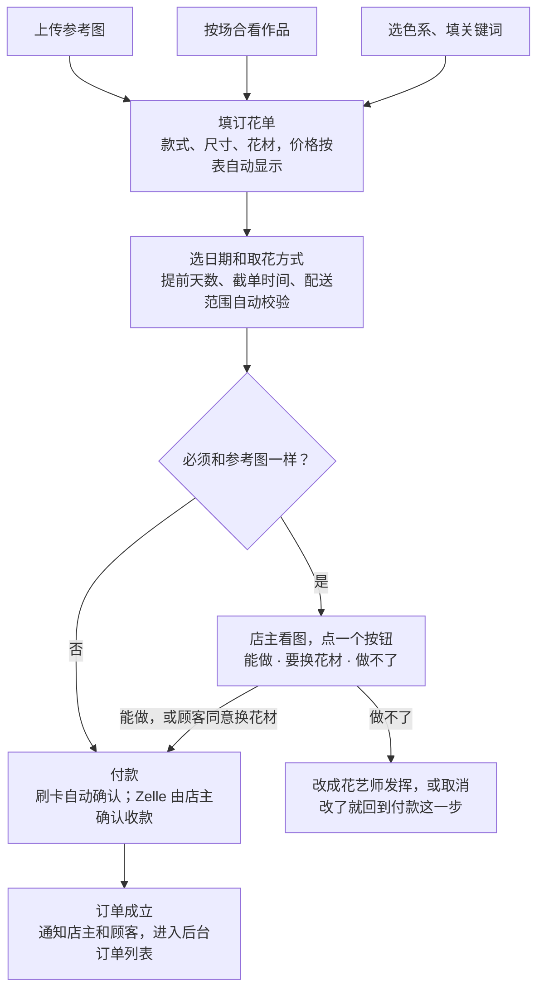

# 订花网站需求文档

版本 0.1 · 2026-11-05

## 目标与范围

网站要做的事只有一件：把店主现在在微信、小红书里一句句问出来的信息，变成顾客自己填的一张订花单，填完就能付款。

店主从“每单聊十几句”变成“大部分订单不用回复，少数订单点一下确认”。

**第一版做**

- 顾客用手机打开链接，按步骤填单、看到价格、付款
- 上传参考图，问能不能做
- 店主后台：看订单、确认参考图、确认收款、标记完成
- 新订单提醒店主，订单状态通知顾客

**第一版不做**

- 顾客注册登录（用订单号加手机号查单就够）
- 库存管理、会员积分、优惠券
- 自动识别参考图里的花材（放到后面，见分期）

## 现状

花店不卖固定款，卖的是“按预算定制”：顾客给风格、色系、关键词和预算，花艺师自由发挥。这一点决定了网站不是商品货架，而是一张引导式订花单。

以下按《订花指南》图片整理，默认它就是朋友店里现在在用的规则。

| 环节 | 现在的做法 |
| --- | --- |
| 顾客从哪来 | 微信、小红书私信 |
| 顾客告诉店主 | 心仪风格、色系、星座、关键词，加上预算 |
| 款式 | 花束、抱抱桶、立式花篮、永生花 |
| 尺寸 | 小（直径 20–30cm）、中（30–40cm）、大（40–50cm）、巨型（50–60cm） |
| 价格 | 按花材类型和尺寸查表，见「价格规则」 |
| 取花 | 自提或配送，配送需要日期、收花人姓名、地址、电话、卡片内容 |
| 付款 | 待确认 |

店主的时间花在三件事上：问清需求、报价、收集配送信息。三件都有固定规则，都能让顾客自己完成。

## 三类顾客怎么走

三类顾客只是入口不同，最后都汇到同一张订花单。只有“指定要和参考图一样”的订单需要店主点一次确认。

| 顾客 | 网站上怎么走 | 需要店主吗 |
| --- | --- | --- |
| 拿图来问能不能做 | 上传参考图，选款式和尺寸，价格按表自动出。再选一项：“花材可以用相近的替换”或“必须和图一样” | 接受替换：不需要，直接付款。必须一样：店主看图后点“能做”“要换花材”或“做不了”，顾客再付款 |
| 说个节日让推荐 | 选场合（生日、纪念日、情人节、母亲节、毕业、开业、探望等），网站展示店里做过的同场合作品和对应档位，顾客点“照这个感觉做” | 不需要 |
| 有颜色或风格要求 | 选色系（可多选），填关键词或星座，花艺师自由发挥 | 不需要 |

“推荐”靠的是作品图库：店主把做过的花的照片传上去，每张标上场合、色系、款式、尺寸档位。顾客看到的是真实作品和真实价格，店主不用每次翻相册发图。

## 订花主流程

顾客七步填完一张单，全程只有一种情况会停下来等店主。

不要求和图一样的订单从填单到付款不经过店主；要求一样的，店主点一次按钮后顾客再付款。

顾客依次填写：

1. 入口：上传参考图、按场合看作品，或直接选色系和关键词。三种可以叠加
2. 款式：花束、抱抱桶、立式花篮、永生花
3. 尺寸：小、中、大、巨型，配尺寸对照图
4. 花材：纯玫瑰（可选厄瓜多尔玫瑰）或多花材。到这一步显示价格
5. 日期和取花方式：自提或配送，配送填收花人、地址、电话
6. 卡片内容和订花人联系方式
7. 确认页：核对全部信息和总价，付款

## 价格规则

价格不用店主报，网站按“花材类型 × 尺寸”查表，顾客选完就看到总价。下表是花束的价格，来自订花指南。

| 花材（美元） | 小 | 中 | 大 | 巨型 |
| --- | --- | --- | --- | --- |
| 纯玫瑰 | 98 | 128 | 158 | 188 |
| 纯玫瑰，厄瓜多尔玫瑰（每档 +20） | 118 | 148 | 178 | 208 |
| 多花材 | 128 | 168 | 198 | 228 |

算价规则：

- 订单金额 = 表中价格 + 配送费（自提或达到免配送档位时为 0）
- 顾客选尺寸时看到的是订花指南里那组“人抱着花”的尺寸对照图，每个尺寸下面直接标价
- 价格表放在后台，店主自己能改，节日调价不用找人改代码

还缺的价格，需要朋友补上：

- 抱抱桶、立式花篮、永生花各自的价格或起价
- 顾客预算高于巨型档（比如 300 美元）时怎么处理：建议加一个“自定义预算”选项，填金额，花艺师按这个金额做
- 情人节、母亲节等节日是否涨价
- 销售税怎么收，价格是含税还是另加

## 时间与配送规则

订花指南里的文字规则，网站直接做成“选不了”或“必须勾选”，顾客不用读规则，店主不用解释。

| 情况 | 网站怎么处理 | 来源 |
| --- | --- | --- |
| 指定花材，或必须和参考图一样 | 日期最早只能选 3 天后 | 订花指南 |
| 当天或 3 天内要 | 只能选“用店里现有花材，花艺师发挥” | 订花指南 |
| 当天单 | 过了截单时间就不能选当天 | 截单时间待确认 |
| 自提 | 显示店铺地址和可取花时段 | 地址和时段待确认 |
| 配送，158 美元及以上档位 | 免费专人专车配送 | 订花指南 |
| 配送，158 美元以下档位 | 第三方配送。顾客必须勾选“第三方配送造成的花损自行负责”才能提交 | 订花指南；配送费待确认 |
| 地址超出配送范围 | 填邮编时提示不在范围内，改为自提 | 范围待确认 |
| 某天订单已满 | 店主在后台把那天设为“已满”，顾客选不了 | 建议新增 |

配送单必填：送花日期、时段、收花人姓名、地址、电话、卡片内容。自提单只填日期、时段和订花人联系方式。

## 付款

要做到“不用人工沟通”，付款必须能自动确认，所以第一版建议以在线刷卡为主，Zelle 作为备选。费率和开户条件以各家官网为准，需要朋友自己开通账号。

| 方式 | 顾客怎么付 | 店主要做什么 | 取舍 |
| --- | --- | --- | --- |
| 在线刷卡、Apple Pay（通过 Stripe 或 Square 这类支付服务） | 在页面上直接付 | 不用操作，付款成功订单自动成立 | 按笔收手续费；全自动，最省沟通 |
| Zelle | 转账并备注订单号 | 收到后在后台点“确认已收款” | 每单要人工核对；用于经营收款的账户要求要问银行 |
| Venmo | 同上 | 同上 | 同样要人工核对；经营收款的账户类型和费用要确认 |
| 微信支付、支付宝 | 用国内钱包付 | 取决于接入方式 | 第一版不做；部分支付服务支持，可以第二版再看 |

什么时候付款：

- 普通订单：填完就付全款，付款成功即订单成立
- 需要店主先确认的订单（必须和参考图一样）：先提交不付款，店主确认后顾客收到付款链接；建议 24 小时内未付自动取消
- 卡号由支付服务的页面收集，网站本身不保存卡号

取消和退款规则目前没有，需要朋友定一条，比如“送花日 48 小时前可全额退款”。

## 店主后台与通知

店主在手机上打开后台（需要登录），每天只看两样：等我确认的单，和按送花日期排好的订单。

后台有四块：

- **待确认**：顾客要求和参考图一样的单。显示图、款式、尺寸、日期，三个按钮：能做、要换花材（写一句换什么）、做不了
- **订单**：按送花日期分成今天、明天、之后。每单显示款式、尺寸、花材、金额、色系和关键词、参考图、取花方式和地址、卡片内容、付款状态
- **操作**：确认已收款（Zelle 单）、标记已做好、标记已送达或已取
- **设置**：价格表、当天截单时间、已满的日期、作品图库（上传照片并标场合、色系、款式、档位）

| 发生了什么 | 通知谁 | 内容 |
| --- | --- | --- |
| 新订单已付款 | 店主 | 订单摘要和后台链接 |
| 有参考图等确认 | 店主 | 参考图和三个选项 |
| 店主已确认或要换花材 | 顾客 | 店主的回复和付款链接 |
| 店主做不了 | 顾客 | 说明，并建议改成花艺师发挥 |
| 付款成功 | 顾客 | 订单号、送花日期、查单链接 |
| 已送达或可取 | 顾客 | 一句话提醒 |

通知走短信或邮件。个人微信没有给网站自动发消息的接口，所以顾客下单时要留手机号或邮箱；微信号可以选填，供店主需要时联系。

## 仍需店主处理的环节

网站能省掉大部分沟通，但有四件事省不掉，只能压到最少。

| 环节 | 为什么省不掉 | 怎么压到最少 |
| --- | --- | --- |
| 判断参考图能不能做 | 只有店主知道能进到什么花 | 顾客勾“可以替换相近花材”就跳过确认；其余的店主点一个按钮 |
| 特殊要求 | 超大预算、超范围配送、临时加急，没有固定规则 | 页面上留一个“联系店主”入口，放微信二维码，不强行自动化 |
| 核对 Zelle 收款 | 转账不经过网站 | 顾客备注订单号，店主点一下确认；走在线刷卡则不需要 |
| 把顾客引到网站 | 小红书对站外链接限制较多，顾客多半还是先私信 | 店主回一条固定消息加链接或二维码，后面的事交给网站 |

网站必须在微信内置浏览器里能正常打开和付款，因为大部分顾客会在微信里点开链接。这一点要在开发时实测。

## 分期

第一版只要让一位顾客能不找店主就订到花，就算成功。

| 阶段 | 内容 |
| --- | --- |
| 第一版 | 订花单（款式、尺寸、花材、色系和关键词、参考图）；自动算价；时间和配送规则；在线付款；按场合看作品（简单图库）；店主后台；短信或邮件通知；订单号查单 |
| 第二版 | 节日预订页（情人节、母亲节提前开放，可限量）；中英双语；老顾客一键再订；微信支付或支付宝 |
| 以后 | 自动识别参考图里的花材，对照店里能进的花，先给店主一个预判；重要日期提醒（生日、纪念日前一周） |

## 待确认

下面这些定下来，规则就完整了。前六条会直接改变网站逻辑，优先问。

- [ ] 订花指南上的价格和规则是不是现在在用的；店铺在哪个城市，配送范围多大
- [ ] 抱抱桶、立式花篮、永生花的价格
- [ ] 158 美元以下档位的配送费，用哪家第三方配送
- [ ] 当天单几点截单，一天最多接多少单
- [ ] 现在怎么收款，愿不愿意开通在线刷卡的商户账号
- [ ] “必须和参考图一样”的单，是否接受“先确认后付款”
- [ ] 自提地址和可取花时段
- [ ] 销售税：价格含税还是另加
- [ ] 取消和退款规则
- [ ] 节日是否涨价、是否限量
- [ ] 网站只做中文，还是中英双语
- [ ] 作品照片大概多少张，有没有按场合或色系分过类
- [ ] 小红书链接里想参考的是什么：店铺主页、某个作品，还是别家的做法
